<div align="center">


# Mâh-ı Nev

**Hilâl Rasad Yardımcısı · Crescent Sighting Assistant**

*Tam İlmihâl Se'âdet-i Ebediyye esaslı kamerî ay başı rasad yardımcısı*

[](CHANGELOG.md)
[](LICENSE)


**[▶ Çevrimiçi aç](https://bemiroglu.github.io/MahiNev/)** &nbsp;·&nbsp;
**[⬇ İndir (v0.11.0)](https://bemiroglu.github.io/MahiNev/mahinev-v0.11.0.html)** &nbsp;·&nbsp;
**[📖 Tam İlmihâl](https://www.hakikatkitabevi.net/book.php?bookCode=001)** &nbsp;·&nbsp;
**[English ↓](#english)**

</div>

> [!IMPORTANT]
> **Bu program bir takvim değildir.** Kamerî ay başı, hilâlin çıplak gözle görülmesiyle (rü'yet) kesinleşir. Programın verdiği her sonuç *hesâbî imkândır*. Hüküm, şahitlik şartlarıyla ve yetkili makamca verilir (Tam İlmihâl, s. 315–316, 360).

## Bu araç hakkında

Mâh-ı Nev, Tam İlmihâl Se'âdet-i Ebediyye kitabındaki bilgiler esas alınarak hazırlanmış bir rasad yardımcısıdır. Hilâl rasadının planlanmasını ve sahada yapılmasını kolaylaştırmak için yapılmıştır.

Bir fıkıh kaynağı değildir; kaynağın yerini tutmaz. Esas ve kesin bilgi fıkıhtır: Bu programda kitaba ve fıkha uymayan bir bilgi bulunursa, o bilgi geçersizdir. Fıkhî hükümler için kitabın kendisine başvurunuz.

- **Kitabı okuyun veya indirin (Hakîkat Kitâbevi):** [kitabın sayfası](https://www.hakikatkitabevi.net/book.php?bookCode=001) · [PDF](https://www.hakikatkitabevi.net/downloads/001.pdf)
- Programdaki sayfa numaraları kitabın **Ocak 2026 baskısına** göredir; başka baskılarda birkaç sayfa farklı olabilir.

<p align="center">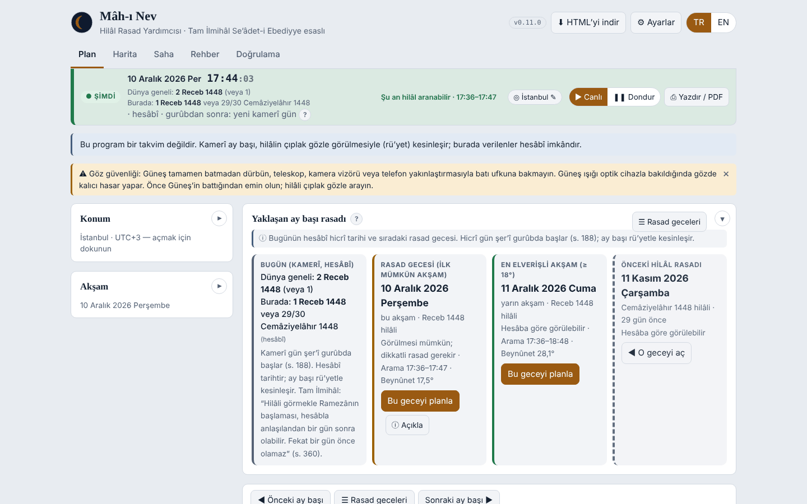</p>

## Tek dosya, her ekranda

Mâh-ı Nev tek bir HTML dosyasıdır. Kurulum gerektirmez: indirip tarayıcıda açmanız yeterlidir. Bilgisayarda, tablette ve telefonda aynı dosya çalışır; açıldıktan sonra internet gerekmez.

<table>
<tr>
<td align="center" width="46%">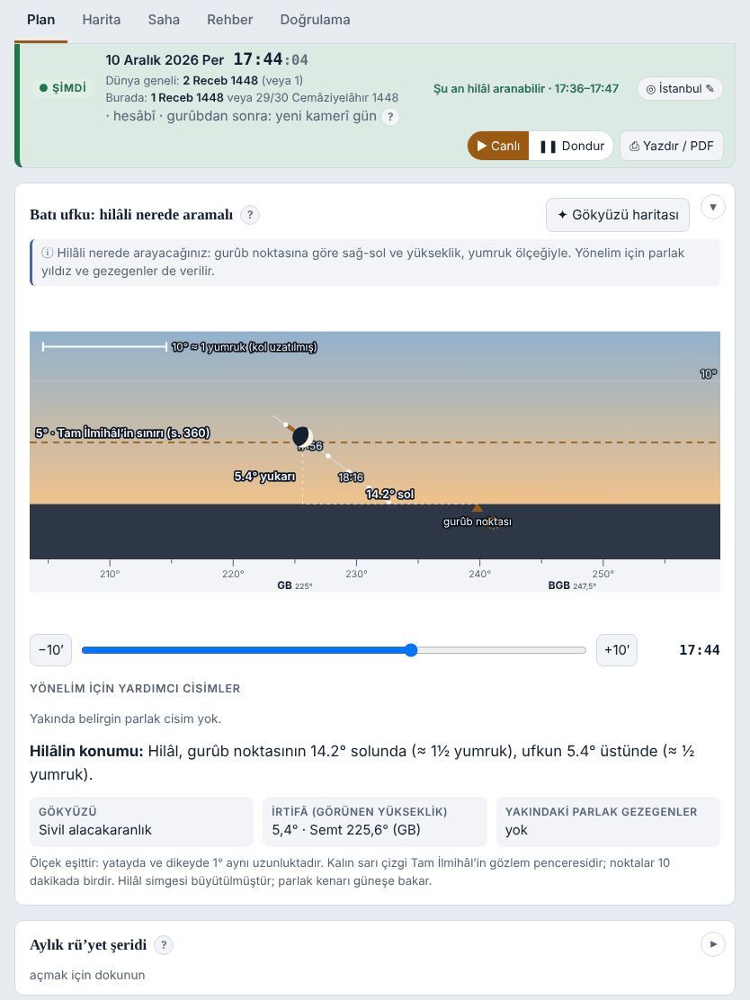<br><sub><b>Tablet</b> · Batı ufku: hilâlin yeri, yumruk ölçeğiyle</sub></td>
<td align="center" width="27%">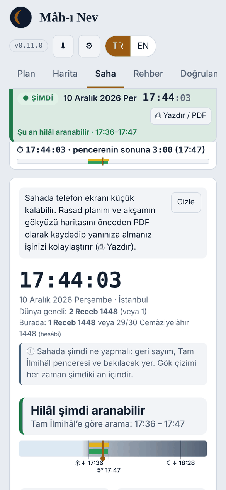<br><sub><b>Telefon</b> · Saha: canlı saat ve geri sayım</sub></td>
<td align="center" width="27%">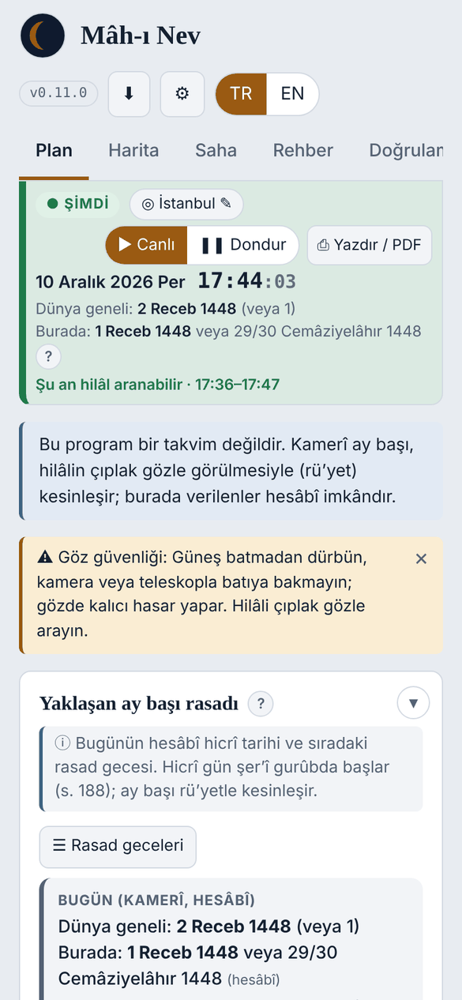<br><sub><b>Telefon</b> · Plan: hicrî gün ve rasad gecesi</sub></td>
</tr>
</table>

<sub>Ekran görüntüleri: İstanbul, 10 Aralık 2026 akşamı (Receb 1448 hilâli), arama penceresi içinde.</sub>

## Nasıl başlarım?

1. [Çevrimiçi adresi](https://bemiroglu.github.io/MahiNev/) açın veya dosyayı indirip tarayıcıda açın.
2. **Konum:** Şehrinizi seçin ya da "Konumumu kullan"a dokunun. Arz ve tûlü dilediğiniz biçimde yazabilirsiniz (41,0082 · 41°00'29"K).
3. **Yaklaşan ay başı rasadı** kartında rasad gecesini görün; "Bu geceyi planla" ile o akşama gidin.
4. Rasad akşamı telefondan **Saha** sekmesini açın: saat, geri sayım, bakılacak yön ve gökyüzü çizimi oradadır.
5. Gördüğünüzde veya göremediğinizde **Rü'yet kaydı** oluşturun. Kaydı A4 tutanak olarak basabilir, JSON olarak paylaşabilirsiniz.

> [!TIP]
> Programın içindeki **⬇ HTML'yi indir** düğmesi, o anda kullandığınız sürümü tek dosya olarak kaydeder. Dosyayı internetsiz bir telefona veya bilgisayara kopyalayıp orada da kullanabilirsiniz.

## Ne yapar?

| | |
|---|---|
| 🌙 **Bu akşamın değerlendirmesi** | Tam İlmihâl'in sınıflarına göre: ictimâ, beynûnet 8° / 18° ve ufuktan 5° (s. 360). Kesin red, rü'yet beyanı ve Kâdîhân kontrolü (s. 316) birlikte verilir. Kâdîhân kontrolünde İmâm-ı a'zam kavli (−19°) esastır; İmâmeyn kavli (−17°) sonucuyla birlikte alternatif olarak gösterilir. |
| ⏱ **Arama penceresi** | Gurûbdan hilâlin 5°'ye indiği âna kadar sürer. Yanında aranabilir aralık da gösterilir; aralığın karanlık eşiği seçilebilir. |
| 🧭 **Nereye bakmalı** | Batı ufku çizimi, 360° bütün ufuk ve gökyüzü haritası. Hilâlin yeri gurûb noktasına göre derece ve "yumruk" ölçeğiyle verilir; yönelim için parlak yıldız ve gezegenler gösterilir. Zaman sürgüsüyle akşamın her ânı görülebilir. |
| 📅 **Ay başı planlaması** | Yaklaşan ve önceki rasad gecesi; **◀ Önceki ay başı / Sonraki ay başı ▶** düğmeleri ve 13 aylık **rasad geceleri listesi**; hicrî aylara göre gruplanmış rü'yet şeridi; hesâben en erken gün (dünya geneli ve yerel). |
| 🗓 **Hicrî tarih** | Kamerî gün şer'î gurûbda değişir (s. 188). İki ihtimalin bulunduğu günlerde ikisi birlikte gösterilir. Zilhiccede ana gösterim kitabın bildirdiği Işık usulüdür (s. 326). |
| 🗺 **Dünya rü'yet imkânı haritası** | Akşam ve anlık kipler; Tam İlmihâl sınıfları, ilk görünürlük katmanı, hilâl yaşı çizgileri ve 18° gurûb boylamı. |
| ❔ **"Bu akşam ne demek?"** | Seçili akşam ve yer için açıklama penceresi: hilâlin burada ve dünyada durumu; "bir gün sonra olabilir, önce olamaz" sınırı (s. 360) ve ayın otuz günü aşmaması (s. 314–315); önceki ayın başına göre her ihtimal şartlı olarak ("önceki ay … günü başladıysa"); ayın adına göre kapsam ve hüküm. Rü'yetsiz hüküm kurmaz. |
| 📱 **Saha kipi** | Telefonda açık havada kullanım için: canlı saat, sabit duran geri sayımlar, gece (kırmızı) ve güneş altı temaları, ekranın açık kalması. **Pusula kadranı** hilâle kaç derece dönüleceğini söyler; Güneş'e çevrilerek manyetik sapma düzeltilir. |
| 📝 **Rü'yet kaydı ve tutanak** | Gözlem şartları, fotoğraf, SHA-256 bütünlük özeti ve cihaz imzası (ECDSA). A4 tutanak imza satırları ve QR koduyla basılır; kayıt sonradan doğrulanabilir. **Bildirim ekleri** kaydın kime, ne zaman ve nasıl bildirildiğini, kaydı değiştirmeden ve ayrıca imzalı olarak saklar. |
| 🖨 **A4 çıktılar** | Rasad planı, gökyüzü haritası (seçili an ve seçili akşam), aylık rü'yet imkânı çizelgesi, dünya rü'yet imkânı haritası ve tutanak; her biri tek sayfaya sığar. PDF veya JPG olarak kaydedilir; dosya adları tarih, saat ve yere göre sıralanır. |
| 🔒 **Gizlilik** | Kayıtlar, isimler ve konum yalnız tarayıcınızda durur. Program, siz izin vermedikçe internete bağlanmaz. Hava tahmini ve internet yazı tipleri Ayarlar'dan açılır; ikisi de başlangıçta kapalıdır. |
| 👁 **Göz güvenliği** | Güneş batmadan dürbün, kamera veya teleskopla batıya bakmayın. Hilâl çıplak gözle aranır. |
| 📚 **Rehber** | Her konuda fıkhî esas ve bilimsel açıklama, kısa ve ayrıntılı; **Naklî deliller** konusu (âyet, hadîs, icmâ ve âlimlerin bildirdikleri). |
| ➕ **Ek bilgiler** | Modern ölçütler (Yallop, Odeh, Danjon) ve aritmetik takvim usulleri yalnızca ek bilgi olarak, kitabın hükmünden sonra verilir. |

<p align="center">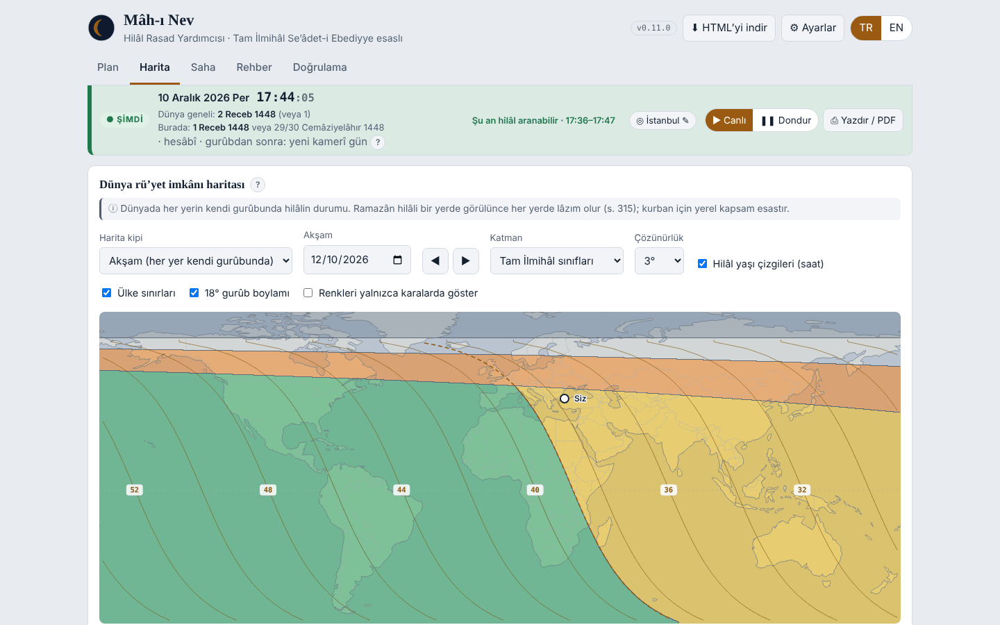<br><sub>Dünya rü'yet haritası: her yerin kendi gurûbunda hilâlin Tam İlmihâl'e göre durumu.</sub></p>

<p align="center">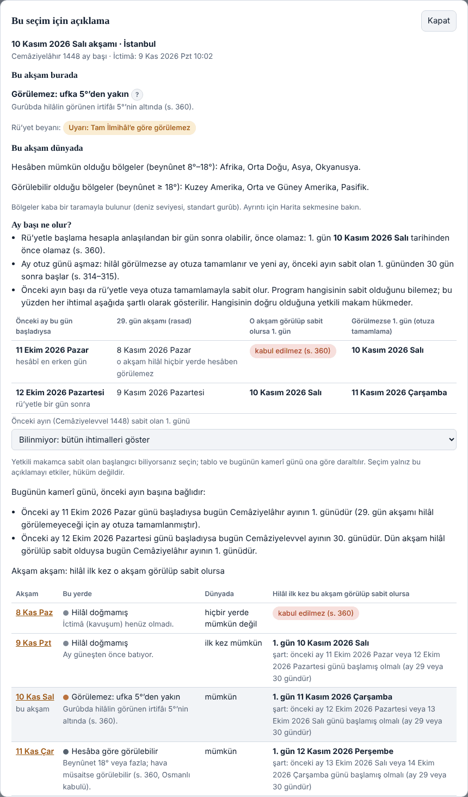<br><sub>"Bu akşam ne demek?" penceresi: 10 Kasım 2026, İstanbul. Önceki ayın başı bilinmediği için her ihtimal şartlı gösterilir.</sub></p>

### A4 çıktı örnekleri

İstanbul, 10 Aralık 2026 akşamı (Receb 1448), programın JPG çıktıları. Büyük hâli için resme dokunun.

<table>
<tr>
<td align="center" valign="bottom"><a href="docs/img/ciktilar/MahiNev_2026-12-10_1742_Istanbul_rasad-plani.jpg">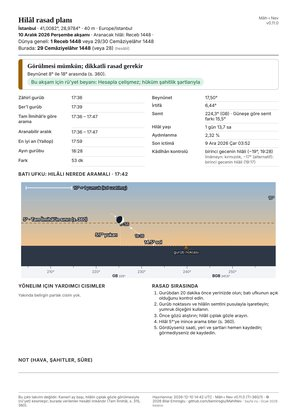</a><br><sub>Rasad planı</sub></td>
<td align="center" valign="bottom"><a href="docs/img/ciktilar/MahiNev_2026-12-10_Istanbul_gokyuzu-aksam.jpg">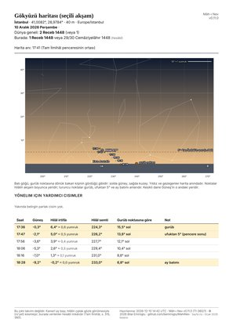</a><br><sub>Gökyüzü haritası (seçili akşam)</sub></td>
<td align="center" valign="bottom"><a href="docs/img/ciktilar/MahiNev_2026-12-10_Istanbul_aylik-cizelge.jpg">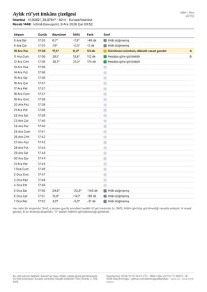</a><br><sub>Aylık rü'yet imkânı çizelgesi</sub></td>
<td align="center" valign="bottom"><a href="docs/img/ciktilar/MahiNev_2026-12-10_1742_Istanbul_dunya-haritasi.jpg">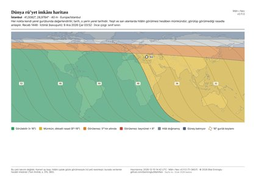</a><br><sub>Dünya rü'yet imkânı haritası</sub></td>
</tr>
</table>

## Yayın adresi ve bütünlük

Programın özgün dosyası yalnızca [github.com/bemiroglu/MahiNev](https://github.com/bemiroglu/MahiNev) adresinde yayımlanır. Her HTML dosyasında lisans bilgisi ve bu adres bulunur.

Program açılışta kendi bütünlüğünü denetler. Dosya değiştirilmişse ekranın üstünde **"değiştirilmiş kopya"** uyarısı çıkar. Aynı ibare baskı çıktılarına ve rü'yet kayıtlarına da yazılır.

## Doğrulama

- **Program içinde:** Doğrulama sekmesinde 59 test bulunur. Testler kitaptaki örnekleri (Receb 1400, s. 360), Kongre tebliğindeki Receb 1437 vakasını, şafak ve temkin usulünü (s. 178, 197), yaz saati geçişlerini, Yallop ölçütünü, küresel kapsamı ve kayıt bütünlüğünü sınar.
- **Uçtan uca tarama:** `tests/ui_tarama.py`; 2 ekran boyutu, 2 dil, 5 tema, bütün sekmeler, diyaloglar ve 9 uç konum (kutup gecesi, tarih çizgisi, yaz saati, Mekke). Hata, taşma ve dış istek arar.
- **Küresel kapsam:** `tools/kuresel_dogrulama.py`
- **Rü'yet kaydı:** `tools/verify_record.py` ile bir kaydın özeti, imzası ve QR kodu bilgisayarda doğrulanır.

Program bir gözlem **planlama ve kayıt** yardımcısıdır; bağımsız bir efemeris referansı veya fıkhî karar sistemi değildir.

## Esaslar

Bütün kararlarda hayati ölçü, Tam İlmihâl'e (Ehl-i sünnet fıkhı) tam uymaktır. Sıralama şöyledir:

1. Tam İlmihâl;
2. kitabın açık eşikleri (8°, 18°, 5°);
3. en hassas modern efemeris;
4. modern gözlem ölçütleri (yalnızca ek bilgi).

| Belge | İçerik |
|---|---|
| [kanonik-metin.md](docs/kanonik-metin.md) | Temel kural metni |
| [kanonik-rapor.md](docs/kanonik-rapor.md) | Esaslar, terminoloji, doğrulama örnekleri ve alınan kararlar |
| [kullanim-kilavuzu.md](docs/kullanim-kilavuzu.md) | Kullanım kılavuzu |
| [kayit-semasi.md](docs/kayit-semasi.md) | Rü'yet kaydı ve doğrulaması |
| [yol-haritasi.md](docs/yol-haritasi.md) | Planlanan işler |
| [CHANGELOG.md](CHANGELOG.md) | Sürümler |

## Geri bildirim

Hata bildirimi için [Issues](https://github.com/bemiroglu/MahiNev/issues) bölümünü kullanın. Fıkhî bir konu içeren öneriler, Tam İlmihâl'den sayfa numarasıyla gelmelidir. Ayrıntılar: [CONTRIBUTING.md](CONTRIBUTING.md).

## Derleme (geliştirici)

```bash
python3 build.py                 # dist/mahinev.html ve dist/mahinev-v<sürüm>.html
pip install playwright && playwright install chromium
python3 tests/run_tests.py       # Doğrulama sekmesindeki testler
python3 tests/ui_tarama.py       # uçtan uca arayüz taraması (uzun sürer)
python3 tools/kuresel_dogrulama.py
```

## Lisans

Mâh-ı Nev © 2026 Bilal Emiroglu. [Creative Commons Atıf-GayriTicari-Türetilemez 4.0 Uluslararası (CC BY-NC-ND 4.0)](https://creativecommons.org/licenses/by-nc-nd/4.0/deed.tr) ile lisanslanmıştır: ticarî olmayan, değiştirilmeden ve kaynak gösterilerek paylaşım. Bkz. [LICENSE](LICENSE).

Gömülü üçüncü taraf bileşenler kendi lisanslarıyla gelir: [THIRD_PARTY_NOTICES.md](THIRD_PARTY_NOTICES.md).

<br>

---

<a id="english"></a>

<div align="center">

# Mâh-ı Nev — English

**Crescent Sighting Assistant based on *Tam İlmihâl Se'âdet-i Ebediyye***

**[▶ Open online](https://bemiroglu.github.io/MahiNev/)** &nbsp;·&nbsp;
**[⬇ Download (v0.11.0)](https://bemiroglu.github.io/MahiNev/mahinev-v0.11.0.html)** &nbsp;·&nbsp;
**[📖 The book](https://www.hakikatkitabevi.net/book.php?bookCode=001)**

</div>

> [!IMPORTANT]
> **This program is not a calendar.** A lunar month begins when the crescent is seen with the naked eye (*ru'yat*). Every result the program gives is a *calculated possibility*. The ruling is given by the competent authority, under the conditions of testimony (Tam İlmihâl, pp. 315–316, 360).

## About this tool

Mâh-ı Nev ("the new moon") is a sighting aid built on the teachings of the book *Tam İlmihâl Se'âdet-i Ebediyye* (Hakîkat Kitâbevi). It helps you plan a crescent watch and carry it out in the field.

It is not a source of fiqh and does not replace the book. Fiqh is the essential and decisive knowledge: anything in this program that does not agree with the book and with fiqh is void. For rulings, consult the book itself.

- **Read or download the book (Hakîkat Kitâbevi):** [book page](https://www.hakikatkitabevi.net/book.php?bookCode=001) · [PDF](https://www.hakikatkitabevi.net/downloads/001.pdf)
- Page numbers in the program refer to the **January 2026 printing**; other printings may differ by a few pages.

<p align="center">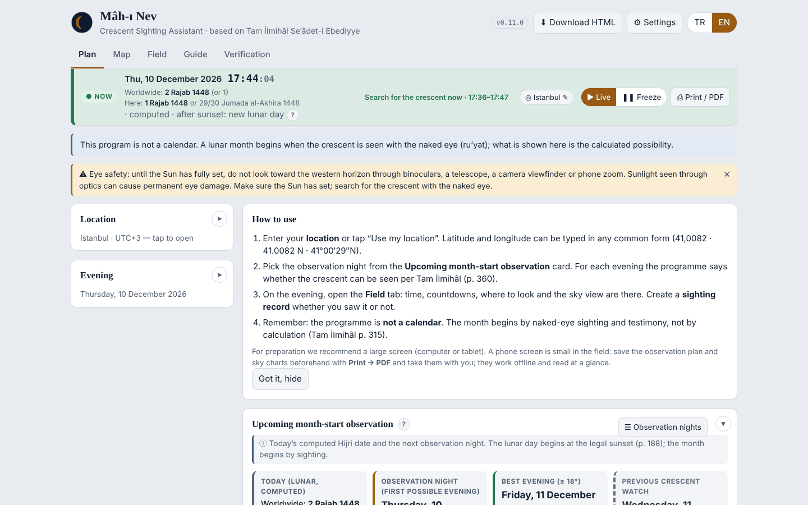<br><sub>The English interface: this evening's assessment and a short how-to for new users.</sub></p>

**A4 output samples.** JPG outputs of the program for Istanbul, evening of 10 December 2026 (Rajab 1448). Tap a picture to open it full size.

<table>
<tr>
<td align="center" valign="bottom"><a href="docs/img/ciktilar/MahiNev_2026-12-10_1742_Istanbul_rasad-plani.jpg"></a><br><sub>Observation plan</sub></td>
<td align="center" valign="bottom"><a href="docs/img/ciktilar/MahiNev_2026-12-10_Istanbul_gokyuzu-aksam.jpg"></a><br><sub>Sky chart (selected evening)</sub></td>
<td align="center" valign="bottom"><a href="docs/img/ciktilar/MahiNev_2026-12-10_Istanbul_aylik-cizelge.jpg"></a><br><sub>Monthly sighting-possibility table</sub></td>
<td align="center" valign="bottom"><a href="docs/img/ciktilar/MahiNev_2026-12-10_1742_Istanbul_dunya-haritasi.jpg"></a><br><sub>World sighting-possibility map</sub></td>
</tr>
</table>

## One file, every screen

Mâh-ı Nev is a single HTML file. Nothing to install: download it and open it in a browser. The same file runs on a computer, a tablet and a phone, and needs no internet once opened. Switch the interface between Turkish and English with the **TR / EN** buttons.

## Getting started

1. Open the [online address](https://bemiroglu.github.io/MahiNev/), or download the file and open it in your browser.
2. **Location:** pick your city or tap "Use my location". Latitude and longitude can be typed in any common form (41.0082 · 41°00'29"N).
3. In the **Upcoming month-start observation** card, find the observation night and go to that evening with "Plan this night".
4. On the evening, open the **Field** tab on your phone: the clock, countdowns, where to look and the sky view are there.
5. Whether you saw the crescent or not, create a **sighting record**. Print it as an A4 report or share it as JSON.

> [!TIP]
> The **⬇ Download HTML** button inside the program saves the version you are using as a single file. You can copy it to an offline phone or computer and use it there.

## What it does

| | |
|---|---|
| 🌙 **This evening's assessment** | By the classes of Tam İlmihâl: conjunction, elongation 8° / 18°, and 5° above the horizon (p. 360). Definite rejection, the sighting claim and the Kâdîhân check (p. 316) are given together. The Kâdîhân check uses Imâm-ı A'zam's view (−19°) as primary; the Imâmeyn view (−17°) is shown as the alternative, with its result. |
| ⏱ **Search window** | From sunset until the crescent comes down to 5°. The searchable interval is shown beside it, with a selectable darkness threshold. |
| 🧭 **Where to look** | Western-horizon drawing, a 360° horizon and a sky chart. The crescent's position is given from the sunset point in degrees and in "fists"; bright stars and planets help orientation. A time slider shows any moment of the evening. |
| 📅 **Month-start planning** | Upcoming and previous observation nights; **◀ Previous / Next month start ▶** buttons and a 13-month **list of observation nights**; a sighting strip grouped by Hijri month; the earliest possible day by calculation (worldwide and local). |
| 🗓 **Hijri date** | The lunar day changes at the legal sunset (p. 188). Where two possibilities exist, both are shown. For Dhu al-Hijja the main display follows the Işık method given in the book (p. 326). |
| 🗺 **World sighting-possibility map** | Evening and instant modes; Tam İlmihâl classes, a first-visibility layer, crescent-age lines and the 18° sunset meridian. |
| ❔ **"What does this evening mean?"** | An explanation window for the selected evening and place: the crescent here and worldwide; the "one day later, never earlier" limit (p. 360) and the rule that a month never exceeds thirty days (pp. 314–315); every possibility shown as a condition on when the previous month began; scope and ruling by month. It never rules without a sighting. |
| 📱 **Field mode** | For outdoor use on a phone: live clock, steady countdowns, night (red) and sunlight themes, keep-screen-on. The **compass dial** tells how many degrees to turn to face the crescent; calibrating on the Sun corrects magnetic variation. |
| 📝 **Sighting record and report** | Observing conditions, photo, SHA-256 integrity digest and a device signature (ECDSA). The A4 report prints with signature lines and a QR code, and the record can be verified later. **Notification annexes** record to whom, when and how the sighting was reported, signed separately and without altering the record. |
| 🖨 **A4 outputs** | Observation plan, sky chart (selected moment and selected evening), monthly sighting-possibility table, world sighting-possibility map and sighting report, each on one page. Save as PDF or JPG; file names sort by date, time and place. |
| 🔒 **Privacy** | Records, names and location stay in your browser only. The program never goes online unless you allow it. Weather forecast and web fonts are switched on in Settings; both start off. |
| 👁 **Eye safety** | Never look west through binoculars, a camera or a telescope before the Sun has set. Search for the crescent with the naked eye. |
| 📚 **Guide** | For each topic the legal basis and a scientific explanation, short or detailed; a **Textual evidence** topic (Qur'an, hadith, consensus and the scholars' reports). |
| ➕ **Additional information** | Modern criteria (Yallop, Odeh, Danjon) and arithmetic calendar methods are given only as additional information, after the book's ruling. |

## Published address and integrity

The original file is published only at [github.com/bemiroglu/MahiNev](https://github.com/bemiroglu/MahiNev). Every HTML file carries the licence and this address.

On opening, the program checks its own integrity. If the file has been altered, a **"modified copy"** warning appears at the top of the screen, and the same words are written on printouts and sighting records.

## Verification

- **In the program:** the Verification tab runs 59 tests: the book's own examples (Rajab 1400, p. 360), the Rajab 1437 case from the congress paper, dawn and *temkin* rules (pp. 178, 197), daylight-saving changes, the Yallop criterion, worldwide scope and record integrity.
- **End-to-end scan:** `tests/ui_tarama.py` covers 2 screen sizes, 2 languages, 5 themes, every tab and dialog, and 9 extreme locations (polar night, date line, daylight saving, Mecca), looking for errors, overflow and outside requests.
- **Worldwide scope:** `tools/kuresel_dogrulama.py`
- **Sighting records:** `tools/verify_record.py` checks a record's digest, signature and QR code on a computer.

The program is an aid for **planning and recording** an observation; it is not an independent ephemeris reference or a system for fiqh rulings.

## Principles

In every decision the vital measure is full agreement with Tam İlmihâl (Ahl al-Sunna fiqh). The order of precedence is:

1. Tam İlmihâl;
2. the book's explicit thresholds (8°, 18°, 5°);
3. the most precise modern ephemeris;
4. modern visibility criteria (additional information only).

The project documents in [`docs/`](docs/) are written in Turkish.

## Feedback

Please use [Issues](https://github.com/bemiroglu/MahiNev/issues) to report problems. Suggestions on a matter of fiqh should come with a page reference from Tam İlmihâl. Details: [CONTRIBUTING.md](CONTRIBUTING.md).

## Building (developers)

```bash
python3 build.py                 # dist/mahinev.html and dist/mahinev-v<version>.html
pip install playwright && playwright install chromium
python3 tests/run_tests.py       # tests from the Verification tab
python3 tests/ui_tarama.py       # end-to-end interface scan (slow)
python3 tools/kuresel_dogrulama.py
```

## Licence

Mâh-ı Nev © 2026 Bilal Emiroglu. Licensed under [Creative Commons Attribution-NonCommercial-NoDerivatives 4.0 International (CC BY-NC-ND 4.0)](https://creativecommons.org/licenses/by-nc-nd/4.0/): non-commercial sharing, unmodified, with attribution. See [LICENSE](LICENSE).

Embedded third-party components come with their own licences: [THIRD_PARTY_NOTICES.md](THIRD_PARTY_NOTICES.md).
