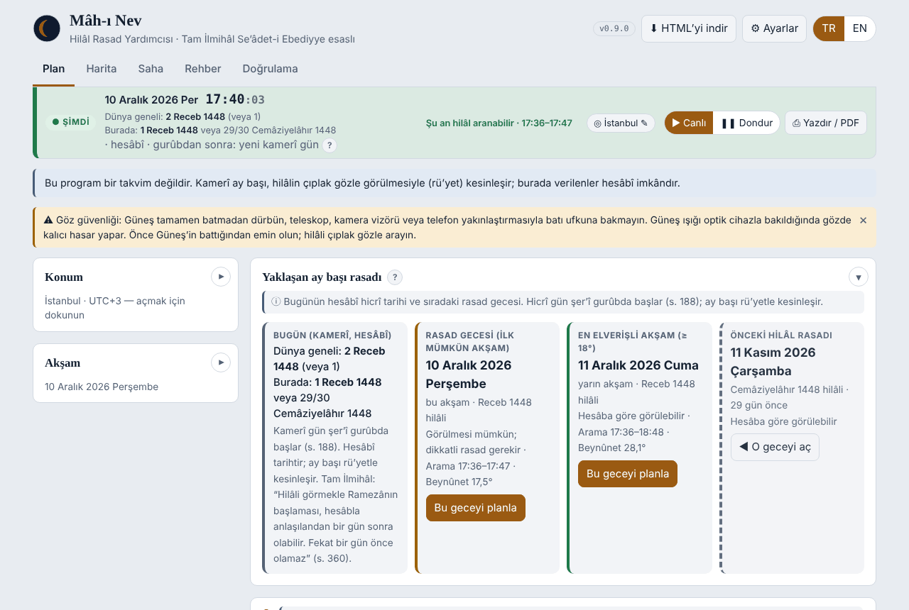
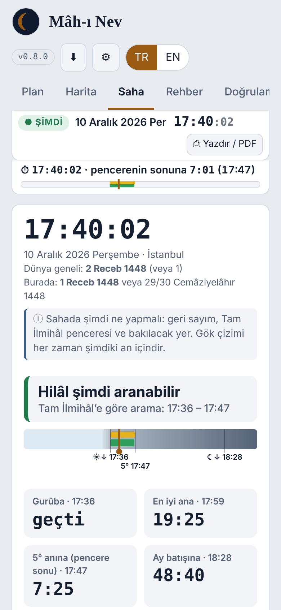
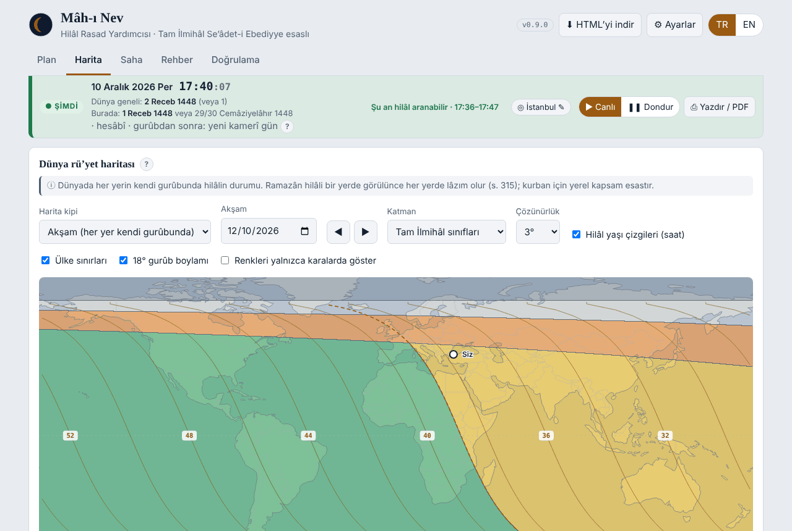

# Mâh-ı Nev

**Hilâl Rasad Yardımcısı · Crescent Sighting Assistant**

*Tam İlmihâl Se'âdet-i Ebediyye (Hakîkat Kitâbevi) esaslı kamerî ay başı rasad yardımcısı*

> **Bu program bir takvim değildir.** Kamerî ay başı, hilâlin çıplak gözle görülmesiyle (rü'yet) kesinleşir. Programın verdiği her sonuç *hesâbî imkândır*. Hüküm, şahitlik şartlarıyla ve yetkili makamca verilir (Tam İlmihâl, s. 315–316, 360).

Mâh-ı Nev ("yeni ay", hilâl) tek bir HTML dosyasıdır. Kurulum gerektirmez; indirip tarayıcıda açmanız yeterlidir. İnternetsiz çalışır ve Türkçe ile İngilizce arayüzü vardır.

| | |
|---|---|
| **Çevrimiçi kullan** | <https://bemiroglu.github.io/MahiNev/> |
| **İndir (son sürüm)** | [`dist/mahinev.html`](dist/mahinev.html) → sayfada *Download raw file* |
| **Değişiklikler** | [CHANGELOG.md](CHANGELOG.md) |
| **Lisans** | [CC BY-NC-ND 4.0](LICENSE): ticarî olmayan, değiştirilmeden, kaynak gösterilerek paylaşım |

Programın içinden de **⬇ HTML'yi indir** düğmesiyle o anda kullandığınız sürümü tek dosya olarak indirebilirsiniz.



## Nasıl başlarım?

1. [Çevrimiçi adresi](https://bemiroglu.github.io/MahiNev/) açın veya `mahinev.html` dosyasını indirip tarayıcıda açın.
2. **Konum:** Şehrinizi seçin ya da "Konumumu kullan"a dokunun. Arz ve tûlü dilediğiniz biçimde yazabilirsiniz (41,0082 · 41°00'29"K).
3. **Yaklaşan ay başı rasadı** kartında rasad gecesini görün, "Bu geceyi planla" ile o akşama gidin.
4. Rasad akşamı telefondan **Saha** sekmesini açın: saat, geri sayım, bakılacak yön ve gökyüzü çizimi oradadır.
5. Gördüğünüzde veya göremediğinizde **Rü'yet kaydı** oluşturun; A4 tutanak olarak basabilir, JSON olarak paylaşabilirsiniz.

<p align="center"></p>

## Bu araç hakkında

Mâh-ı Nev, Tam İlmihâl Se'âdet-i Ebediyye kitabındaki bilgiler esas alınarak hazırlanmış bir rasad yardımcısıdır. Hilâl rasadının planlanmasını ve sahada yapılmasını kolaylaştırmak için yapılmıştır.

Bir fıkıh kaynağı değildir; kaynağın yerini tutmaz. Esas ve kesin bilgi fıkıhtır: Bu programda kitaba ve fıkha uymayan bir bilgi bulunursa, o bilgi geçersizdir. Fıkhî hükümler için kitabın kendisine başvurunuz.

- **Kitabı okuyun veya indirin (Hakîkat Kitâbevi):** [kitabın sayfası](https://www.hakikatkitabevi.net/book.php?bookCode=001) · [PDF](https://www.hakikatkitabevi.net/downloads/001.pdf)
- Programdaki sayfa numaraları kitabın **Ocak 2026 baskısına** göredir; başka baskılarda birkaç sayfa farklı olabilir.

## Yayın adresi

Programın özgün dosyası yalnızca [github.com/bemiroglu/MahiNev](https://github.com/bemiroglu/MahiNev) adresinde yayımlanır. Her HTML dosyasında lisans bilgisi ve bu adres bulunur.

Program açılışta kendi bütünlüğünü denetler. Dosya değiştirilmişse ekranın üstünde **"değiştirilmiş kopya"** uyarısı çıkar. Aynı ibare baskı çıktılarına ve rü'yet kayıtlarına da yazılır.

## Ne yapar?

- **Bu akşamın hilâl değerlendirmesi:**
  - Değerlendirme Tam İlmihâl'in sınıflarına göre yapılır: ictimâ, beynûnet 8°/18° ve ufuktan 5° (s. 360).
  - Kesin red, rü'yet beyanı ve Kâdîhân kontrolü (s. 316) birlikte verilir.
  - Kâdîhân kontrolünde İmâm-ı a'zam kavli (−19°) esastır. İmâmeyn kavli (−17°) alternatif olarak sonucuyla birlikte gösterilir.
- **Arama penceresi:** Gurûbdan hilâlin 5°'ye indiği âna kadar sürer. Program bunun yanında aranabilir aralığı da gösterir; aralığın karanlık eşiği seçilebilir.
- **Günün her saati için gözlem durumu:**
  - batı ufku çizimi, 360° bütün ufuk ve gökyüzü haritası;
  - yönelim için parlak yıldız ve gezegenler, hilâle göre konumlarıyla.
- **Ay başı rasadı planlaması:**
  - yaklaşan ve önceki ay başı rasad gecesi;
  - aylık rü'yet şeridi;
  - hesâbî en erken gün (dünya geneli ve yerel).
- **Hicrî tarih:**
  - Kamerî gün şer'î gurûbda değişir (s. 188).
  - İki ihtimalin bulunduğu günlerde ikisi birlikte gösterilir.
  - Yerel kapsam dünya genelinden farklıysa ikinci satırda yazılır.
- **Dünya rü'yet haritası:** Akşam ve anlık kipleri vardır; ilk görünürlük katmanı ve 18° gurûb boylamı da gösterilir.
- **Saha kipi (telefon, açık hava):**
  - canlı saat ve sabit duran geri sayımlar;
  - gece (kırmızı) ve güneş altı temaları;
  - pusula ve ekranın açık kalması.
- **Rü'yet kaydı ve tutanak:**
  - Kayıt; gözlem şartlarını, fotoğrafı, SHA-256 bütünlük özetini ve cihaz imzasını (ECDSA) içerir.
  - Tutanak A4 olarak, imza satırları ve QR kodu ile basılır.
- **Odaklı A4 çıktılar:** rasad planı, gökyüzü haritası, aylık çizelge, dünya haritası ve tutanak; her biri tek sayfaya sığar. Sayfalar PDF ya da JPG olarak kaydedilir.
- **Gizlilik:** Kayıtlar, isimler ve konum yalnız tarayıcınızda durur. Program, siz açmadıkça internete hiç bağlanmaz. Hava tahmini ve internet yazı tipleri Ayarlar'dan açılır.
- **Göz güvenliği:** Güneş batmadan dürbün, kamera veya teleskopla batıya bakmayın. Hilâl çıplak gözle aranır.
- **Ek bilgiler:**
  - Modern ölçütler (Yallop, Odeh, Danjon) yalnızca ek bilgi olarak verilir.
  - Aritmetik takvim usulleri yalnızca takvim bilgisi olarak gösterilir.
- **İsteğe bağlı çevrimiçi katman:** hava ve görüş tahmini (Open-Meteo) ve internet yazı tipleri; ikisi de başlangıçta kapalıdır. Otomatik konum cihaz izniyle çalışır ve internet kullanmaz.

## Doğrulama

- **Program içinde:** Doğrulama sekmesinde 52 test bulunur. Bunlar kitaptaki örnekleri (Receb 1400, s. 360), şafak ve temkin usulünü (s. 178, 197), yaz saati geçişlerini, Yallop ölçütünü, küresel kapsamı ve kayıt bütünlüğünü sınar.
- **Uçtan uca tarama:** `tests/ui_tarama.py` şunları dener: 2 ekran boyutu, 2 dil, 5 tema, bütün sekmeler, diyaloglar ve 9 uç konum (kutup gecesi, tarih çizgisi, yaz saati, Mekke). Tarama hata, taşma ve dış istek arar.
- **Küresel kapsam:** `tools/kuresel_dogrulama.py`
- **Bağımsız inceleme:** Programın bağımsız bilimsel, fıkhî ve teknik incelemesinde kabul edilen ilkeler [docs/kanonik-rapor.md §16](docs/kanonik-rapor.md)'dadır.

Program bir gözlem **planlama ve kayıt** yardımcısıdır. Bağımsız bir efemeris referansı veya fıkhî karar sistemi değildir.



## Esaslar

Bütün kararlarda hayati ölçü, Tam İlmihâl'e (Ehl-i sünnet fıkhı) tam uymaktır. Hiyerarşi şöyledir:

1. Tam İlmihâl;
2. kitabın açık eşikleri (8°, 18°, 5°);
3. en hassas modern efemeris;
4. modern gözlem ölçütleri (yalnızca ek bilgi).

Belgeler:

- [docs/kanonik-metin.md](docs/kanonik-metin.md): temel kural metni.
- [docs/kanonik-rapor.md](docs/kanonik-rapor.md): esaslar, terminoloji, doğrulama örnekleri ve alınan kararlar.
- [docs/tasarim-ilkeleri.md](docs/tasarim-ilkeleri.md): tasarım ilkeleri; yeni kullanıcıya rehberlik bunlardan biridir.
- [docs/kullanim-kilavuzu.md](docs/kullanim-kilavuzu.md): kullanım kılavuzu.
- [docs/kayit-semasi.md](docs/kayit-semasi.md) ve [docs/sehadet-agi.md](docs/sehadet-agi.md): rü'yet kaydı ve şehâdet ağı.
- [docs/mimari.md](docs/mimari.md) ve [docs/github-otomasyon.md](docs/github-otomasyon.md): mimari ve yayın.
- [docs/yol-haritasi.md](docs/yol-haritasi.md): planlanan işler (gemi kipi, üç kullanıcı düzeyi).

## Geri bildirim

Hata bildirimi ve rü'yet raporu için [Issues](https://github.com/bemiroglu/MahiNev/issues) şablonlarını kullanın. Fıkhî bir konu içeren öneriler, Tam İlmihâl'den sayfa numarasıyla gelmelidir. Ayrıntılar: [CONTRIBUTING.md](CONTRIBUTING.md).

## Derleme (geliştirici)

```bash
python3 build.py                 # dist/mahinev.html ve dist/mahinev-v<sürüm>.html
pip install playwright && playwright install chromium
python3 tests/run_tests.py       # Doğrulama sekmesindeki testler
python3 tests/ui_tarama.py       # uçtan uca arayüz taraması (uzun sürer)
python3 tools/kuresel_dogrulama.py
```

## Lisans

Mâh-ı Nev © 2026 Bilal Emiroglu. [Creative Commons Atıf-GayriTicari-Türetilemez 4.0 Uluslararası (CC BY-NC-ND 4.0)](https://creativecommons.org/licenses/by-nc-nd/4.0/deed.tr) ile lisanslanmıştır; bkz. [LICENSE](LICENSE).

Gömülü üçüncü taraf bileşenler kendi lisanslarıyla gelir: [THIRD_PARTY_NOTICES.md](THIRD_PARTY_NOTICES.md).

---

### English

**Mâh-ı Nev** ("the new moon") is a single-file, offline, bilingual (TR/EN) HTML program that assists the naked-eye sighting of the new crescent according to *Tam İlmihâl Se'âdet-i Ebediyye* (Hakîkat Kitâbevi).

**It is not a calendar.** Everything it shows is computed possibility; the month begins by sighting and testimony.

- **Use online:** <https://bemiroglu.github.io/MahiNev/>
- **Download:** [`dist/mahinev.html`](dist/mahinev.html), or use the **Download HTML** button inside the program.

It is an aid, not a source of fiqh, and it does not replace the book: anything in it that does not agree with the book and with fiqh is void. For rulings, consult the book itself ([Hakîkat Kitâbevi](https://www.hakikatkitabevi.net/book.php?bookCode=001)). Page numbers refer to the January 2026 printing.

The original file is published only at [github.com/bemiroglu/MahiNev](https://github.com/bemiroglu/MahiNev). The program checks its own integrity and marks altered files as a *modified copy*.

Licensed under [CC BY-NC-ND 4.0](LICENSE): non-commercial sharing, unmodified, with attribution. Embedded third-party components keep their own licences.
