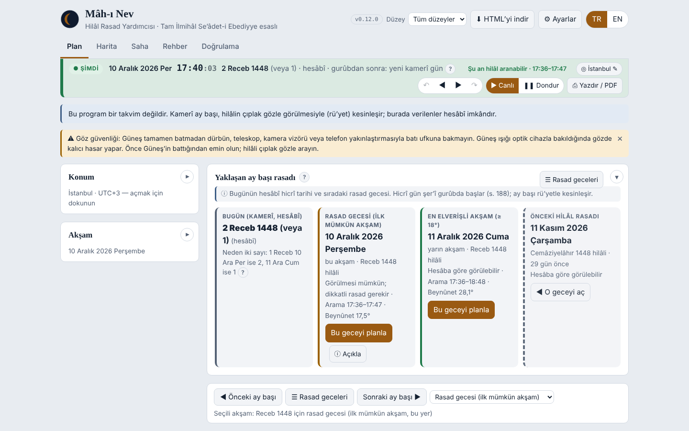

<div align="center">


# Mâh-ı Nev — Hilâl Rasad Yardımcısı

**Crescent Sighting Assistant · Assistant d’observation du croissant · Asistente de avistamiento del creciente · Pomoćnik za viđenje hilala**

*Tam İlmihâl Se'âdet-i Ebediyye esaslı, internetsiz çalışan tek dosyalık hilâl gözlem rehberi*

[](CHANGELOG.md)
[](LICENSE)


**[▶ Çevrimiçi aç](https://bemiroglu.github.io/MahiNev/)** · **[⬇ İndir (v0.15.0)](https://bemiroglu.github.io/MahiNev/mahinev-v0.15.0.html)** · **[🔒 SHA-256](#dogrulama)** · **[📖 Tam İlmihâl](https://www.hakikatkitabevi.net/book.php?bookCode=001)**

[Türkçe](#turkce) · [English](#english) · [Français](#francais) · [Español](#espanol) · [Bosanski](#bosanski)

</div>

<a id="turkce"></a>

> [!IMPORTANT]
> **Mâh-ı Nev**, yeni kamerî ayın hilâlini gözlemlemek isteyen kişiye **nerede, ne zaman, hangi yönde ve hangi şartlarda** gözlem yapabileceğini açıklayan ve **gözlemin kaydedilmesine yardımcı olan bir saha rehberidir.** Bu program, herhangi bir kamerî ayın başladığını ilan eden, dinî hüküm tesis eden veya resmî takvim oluşturan bir sistem **değildir**.

<p align="center"></p>

## Ne sunar?

- **Bu akşam ne zaman, nereye bakmalı:** Gurûb, Tam İlmihâl'in arama penceresi (hilâl 5° irtifâya inene kadar), hilâlin yönü ve yüksekliği; yumruk ölçeğiyle ufuk çizimi ve pusula.
- **Tam İlmihâl'in ölçüleri:** Beynûnet 8°'nin altında kesin red, 8°–18° mümkün, 18° ve üstü görülebilir; ayın 1. günü için iki ihtimal (hesâbî gün veya bir gün sonrası).
- **Dünya haritası:** Hilâlin nerelerde görülebileceği; önceki akşam, birinci ve ikinci gece yan yana.
- **Saha ekranı:** Canlı saat, geri sayım, gökyüzü haritası, göz güvenliği uyarısı; isteğe bağlı ufuk engeli.
- **Kayıt ve tutanak:** Mühürlü (SHA-256, isteğe bağlı cihaz imzası) rü'yet kaydı, A4 tutanak, paylaşma ve gizlilik seçimi. Kayıt şahitlik yerine geçmez.
- **Öğrenme:** "Bu akşam ne demek?" açıklaması, Rehber, deneme (eğitim) kipi ve hazır senaryolar.

Tek bir HTML dosyasıdır: kurulum gerekmez, açıldıktan sonra internetsiz çalışır; bilgisayar, tablet ve telefonda aynı dosya kullanılır. Hesap motoru: Astronomy Engine; bağımsız kaynakla (Astropy) karşılaştırmalı 70 test Doğrulama sekmesindedir.

## Nasıl kullanılır?

1. Programı [çevrimiçi açın](https://bemiroglu.github.io/MahiNev/) veya dosyayı indirip tarayıcıda açın; dili **TR · EN · FR · ES · BS** düğmeleriyle seçin.
2. **Konum**unuzu seçin veya "Konumumu kullan"a dokunun.
3. **Plan**'da yaklaşan rasad gecesini görün; "Bu geceyi planla" ile o akşama gidin.
4. Rasad akşamı **Saha** sekmesini açın; gördüğünüzü veya göremediğinizi **kaydedin**.

## Esaslar

Ölçü Tam İlmihâl'dir; sayfa numaraları Ocak 2026 baskısına göredir. Modern gözlem modelleri (Yallop, Odeh) yalnız ek bilgi olarak, ayrı etiketle gösterilir; takvim birleştirme ölçütleri kullanılmaz. Ayrıntı: [kanonik rapor](docs/kanonik-rapor.md) · [kanonik metin](docs/kanonik-metin.md) · [kullanım kılavuzu](docs/kullanim-kilavuzu.md).

<a id="dogrulama"></a>

## İndirme ve doğrulama (SHA-256)

Programın özgün dosyası yalnız bu depoda ve [bemiroglu.github.io/MahiNev](https://bemiroglu.github.io/MahiNev/) adresinde yayımlanır. İndirdiğiniz dosyanın yayımlanan dosyanın aynısı olduğunu iki yolla denetleyebilirsiniz:

- **Programın içinde:** Alt bilgideki **"Dosyayı doğrula"** bağlantısı (Rehber → Dosyanın doğrulanması). Dosyayı seçin, yayımlanan özeti yapıştırın; program karşılaştırır. Hesap cihazınızda yapılır, dosya gönderilmez.
- **Komutla:** `sha256sum mahinev.html` · Windows: `certutil -hashfile mahinev.html SHA256` · macOS: `shasum -a 256 mahinev.html`

Yayımlanan özetler: [sürüm notları](https://github.com/bemiroglu/MahiNev/releases) ve [SHA256SUMS.txt](https://bemiroglu.github.io/MahiNev/SHA256SUMS.txt). v0.15.0:

```
@@SHA256@@  mahinev.html
```

Dosyayı tarayıcının "Farklı kaydet → Web sayfası, tamamı" seçeneğiyle kaydetmeyin (tarayıcı dosyayı değiştirir); sürüm sayfasındaki dosyayı indirin. Program ayrıca açılışta yerel bir bütünlük denetimi yapar ve değiştirilmiş görünen kopyada uyarır; bu denetim kriptografik imza değildir.

## Belgeler, geri bildirim, lisans

[Sürümler](CHANGELOG.md) · [Kayıt biçimi](docs/kayit-semasi.md) · [Çok dilli yapı](docs/coklu-dil.md) · [Yol haritası](docs/yol-haritasi.md) · [Hata bildirimi](https://github.com/bemiroglu/MahiNev/issues) · [Katkı](CONTRIBUTING.md)

© 2026 Bilal Emiroglu · [CC BY-NC-ND 4.0](https://creativecommons.org/licenses/by-nc-nd/4.0/deed.tr): ticarî olmayan, değiştirilmeden ve kaynak gösterilerek paylaşım · Üçüncü taraf bileşenler: [THIRD_PARTY_NOTICES.md](THIRD_PARTY_NOTICES.md)

<details><summary>Geliştirici</summary>

```bash
python3 build.py                        # dist/mahinev.html, dist/SHA256SUMS.txt
python3 tests/run_tests.py              # Doğrulama sekmesindeki testler
python3 tools/dil/pack_sync.py durum    # çevirilerin kaynakla eşlemesi
python3 tests/ui_tarama.py              # uçtan uca arayüz taraması (beş dil)
```
</details>

---

<a id="english"></a>

## English

> [!IMPORTANT]
> **Mâh-ı Nev** is a **field guide** that tells a person who wants to observe the crescent of the new lunar month **where, when, in which direction and under what conditions** to look, and **helps record the observation**. It is **not** a system that announces the beginning of any lunar month, establishes a religious ruling or produces an official calendar.

- **When and where to look tonight:** sunset, the Tam İlmihâl search window (until the crescent drops to 5° altitude), the crescent's direction and height; horizon drawing with a fist scale, and a compass.
- **The measures of Tam İlmihâl** (English edition: *[Endless Bliss](https://www.hakikatkitabevi.net/book.php?bookCode=025)*): elongation below 8° rejected, 8°–18° possible, 18° and above visible; two possibilities for day 1 of the month.
- **World map, field screen, sealed sighting record and A4 report, sharing with privacy choices, practice mode.**

A single HTML file: nothing to install, works offline once opened. [Open online](https://bemiroglu.github.io/MahiNev/) · [Download](https://bemiroglu.github.io/MahiNev/mahinev-v0.15.0.html) · **Verify the file:** use "Verify the file" in the program's footer, or `sha256sum mahinev.html`, and compare with the digest above and in the [release notes](https://github.com/bemiroglu/MahiNev/releases). Licence: [CC BY-NC-ND 4.0](https://creativecommons.org/licenses/by-nc-nd/4.0/).

<a id="francais"></a>

## Français

> **Mâh-ı Nev** est un **guide de terrain** qui indique à celui qui veut observer le croissant du nouveau mois lunaire **où, quand, dans quelle direction et dans quelles conditions** regarder, et qui **aide à consigner l’observation**. Il **n’annonce pas** le début d’un mois lunaire, n’établit pas de jugement religieux et ne constitue pas un calendrier officiel.

Fichier HTML unique, fonctionne hors ligne. Les références renvoient à *Endless Bliss* (édition anglaise de Tam İlmihâl). Les textes français ont été traduits automatiquement (intelligence artificielle) et vérifiés par retraduction ; des erreurs restent possibles, le texte turc fait foi. [Ouvrir en ligne](https://bemiroglu.github.io/MahiNev/) · [Télécharger](https://bemiroglu.github.io/MahiNev/mahinev-v0.15.0.html) · vérification SHA-256 : « Vérifier le fichier » dans le pied de page du programme.

<a id="espanol"></a>

## Español

> **Mâh-ı Nev** es una **guía de campo** que indica a quien desea observar el creciente del nuevo mes lunar **dónde, cuándo, en qué dirección y en qué condiciones** mirar, y que **ayuda a registrar la observación**. **No** anuncia el comienzo de ningún mes lunar, no establece dictámenes religiosos ni elabora un calendario oficial.

Un único archivo HTML que funciona sin conexión. Las referencias remiten a *Endless Bliss* (edición inglesa de Tam İlmihâl). Los textos en español se tradujeron automáticamente (inteligencia artificial) y se revisaron mediante retrotraducción; puede haber errores, prevalece el texto turco. [Abrir en línea](https://bemiroglu.github.io/MahiNev/) · [Descargar](https://bemiroglu.github.io/MahiNev/mahinev-v0.15.0.html) · verificación SHA-256: «Verificar el archivo» en el pie de página del programa.

<a id="bosanski"></a>

## Bosanski

> **Mâh-ı Nev** je **terenski vodič** koji onome ko želi posmatrati hilal novog kamerijskog mjeseca pokazuje **gdje, kada, u kojem pravcu i pod kojim uslovima** da gleda, i koji **pomaže da se osmatranje zabilježi**. On **ne** objavljuje početak nijednog kamerijskog mjeseca, ne donosi vjerski propis i ne sastavlja zvanični kalendar.

Jedna HTML datoteka, radi bez interneta. Navodi upućuju na *Endless Bliss* (englesko izdanje Tam İlmihâla). Bosanski tekstovi su automatski prevedeni (umjetna inteligencija) i provjereni povratnim prijevodom; greške su moguće, mjerodavan je turski tekst. [Otvori na internetu](https://bemiroglu.github.io/MahiNev/) · [Preuzmi](https://bemiroglu.github.io/MahiNev/mahinev-v0.15.0.html) · SHA-256 provjera: „Provjeri datoteku“ u podnožju programa.
